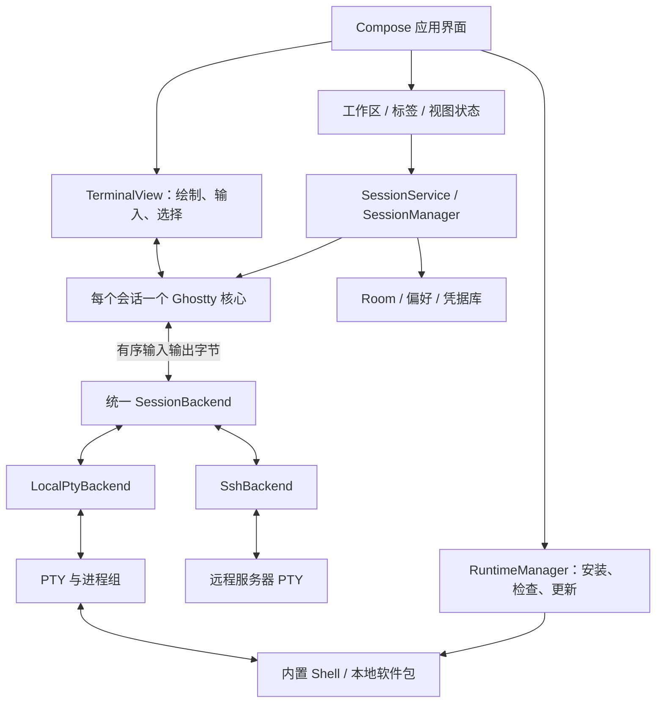

# Puppy：独立 Android 终端设计

日期：2026-10-14。状态：设计基线，可进入技术验证；尚未实现或通过 Android 真机验证。Puppy 暂作项目工作名。

## 1. 已确定的产品边界

| 项目 | 决策 |
| --- | --- |
| 平台 | 仅 Android；手机、折叠屏、横屏使用同一套布局，仅适配可用宽高 |
| 安装 | 一个独立 App，包含自己的本地运行环境，无需另装 Termux |
| 本地终端 | 复用 Termux 的软件环境与构建体系；PTY/进程封装由本产品负责，Termux App 代码不是必要依赖 |
| 远程终端 | 内置 SSH 客户端，与本地终端处于同等地位 |
| 终端核心 | 复用 Ghostty 的 `libghostty-vt`；Android 自行实现绘制与输入适配 |
| 视觉 | 会话标签放侧栏，顶部仅一行标题与操作，无底部状态栏；沿用原平板稿配色与终端样式 |
| 键盘 | 使用系统输入法，以 Unexpected Keyboard 为主要兼容对象；不做自制键盘或辅助键栏 |
| 多会话 | 首版单终端视图、多标签切换；split 不进入首版设计和实施 |
| 主题 | 支持所选上游快照的 Ghostty 官方主题全集，并支持自定义配色导入 |
| 分发 | 首版独立 APK；Google Play 后续单独适配 |
| 许可证 | 按 GPLv3 开源；拟采用 GPL-3.0-only，与实际复用模块逐项核对 |

本地终端直接访问本应用内的 PTY，不启动本机 SSH 服务。远程 SSH 也不依赖本地环境中安装的 `ssh` 命令。

“独立 App”包含自己的用户目录和软件包目录。它不会自动读取另一个 Termux App 的私有文件；如果将来需要迁移数据，应设计显式导入。

## 2. 技术选型

| 层 | 选择 | 职责与理由 |
| --- | --- | --- |
| 应用主语言 | Kotlin | Android 生命周期、输入、系统服务、数据与界面 |
| 应用 UI | Jetpack Compose | 标签、会话选择、SSH 主机、主题浏览、设置；采用自定义设计系统 |
| 终端视图 | 自定义 Android `TerminalView`，由 Compose `AndroidView` 承载 | 集中处理 IME、物理键盘、选择和滚动；避免逐字符创建 UI 组件 |
| 终端状态 | Zig 编写的 `libghostty-vt` | 解析控制序列、维护终端状态，复用可用的键鼠编码与渲染状态 API |
| Native 接口 | Zig 实现 JNI，接入 Ghostty 公开 Zig module API | 保留生命周期、批量字节和帧快照边界；无需新增 C/C++ 中转层 |
| 首版绘制 | Android Canvas / 系统文本绘制 | 优先正确处理字体与输入；性能验证后再决定是否需要专用 OpenGL ES 绘制器 |
| 本地执行 | Termux 派生 bootstrap 与软件包 + 本产品的 PTY/进程封装 | 软件环境与会话传输分开；PTY 是操作系统机制 |
| SSH | SSHJ 作为首轮候选，独立 `SshBackend` 适配 | 真机验证认证、私钥格式与 PTY 后锁定版本；不依赖外部 `ssh` 子进程 |
| 状态与并发 | Kotlin Coroutines、StateFlow、ViewModel | StateFlow 仅承担可合并的 UI 状态；原始终端字节使用可靠有序队列 |
| 持久化 | Room + DataStore | 主机/配置/工作区与偏好；密钥使用单独加密存储 |
| 构建 | Gradle Kotlin DSL + Android NDK + Zig 构建任务 | NDK 提供 Android 目标头文件与链接环境；CMake 仅在具体依赖需要时使用；软件包构建使用独立 Linux 流水线 |

应用自有代码以 Kotlin 和 Zig 为主，首版不增加 Rust、Flutter、React Native 或 WebView 运行时。JNI 是托管代码与原生代码之间的接口规范，不限定实现语言；Zig 可以按其要求导出函数和处理对象。C ABI 描述二进制接口，不代表必须编写 C 源码，也无需再为 Zig 到 Zig 的调用自建一层 C 包装。[Android JNI 指南](https://developer.android.com/ndk/guides/jni-tips)、[Zig C ABI 导出](https://ziglang.org/documentation/0.15.2/#Exporting-a-C-Library)

Ghostty 接入优先使用固定版本的公开 Zig module API，避免访问任意内部实现；接口和工具链升级一起验证。必要时可以从 Zig 调用上游已有 C API，但不把 C API 等同于稳定版本兼容承诺。依赖和软件包仍可能用 C/C++ 编写；本设计不要求为统一语言而重写上游代码。

Ghostty 当前可嵌入的 VT 库与桌面应用完整绘制链路边界不同，API 仍可能变动。正式依赖必须固定提交、Zig 工具链、头文件与构建参数，而不能追随 `main`。[Ghostty 当前状态](https://github.com/ghostty-org/ghostty#cross-platform-libghostty-for-embeddable-terminals)、[官方嵌入示例](https://github.com/ghostty-org/ghostling)

本次核验的上游候选提交已包含 Android NDK 接入与 16 KiB 链接设置，可以直接利用这些构建支持；这仍不等于本产品的输入、字体和真机兼容已通过验收。候选提交及固定源码链接见[终端研究记录](research/terminal.md)。

## 3. 整体架构

### 3.1 模块边界

以下是实施时的逻辑模块，未要求第一天全部拆成独立构建模块。

| 模块 | 负责 | 禁止依赖的细节 |
| --- | --- | --- |
| `app` / `ui` | 导航、主题 UI、屏幕状态、系统权限入口 | PTY 文件描述符、SSH 库具体对象 |
| `terminal-view` | 字形绘制、手势、系统 IME 接收、可访问性 | 键盘 UI、Shell 启动、主机认证 |
| `terminal-core` | Ghostty native handle、键鼠编码、屏幕与滚动状态 | Compose、数据库、Android Activity |
| `session` | 会话注册、生命周期、终端与后端连接 | 软件包内部细节 |
| `backend-local` | 创建 PTY、exec、resize、进程退出和关闭 | 终端转义序列解析 |
| `backend-ssh` | 连接、认证、PTY、窗口变化、断线 | 本地 bootstrap |
| `runtime` | 环境安装、执行策略、软件仓库、修复 | 远程会话 |
| `profiles` / `vault` | 主机配置、known_hosts、密钥引用、导入导出 | 终端屏幕内容 |
| `theme` | Ghostty 主题解析、索引、预览、界面色彩映射 | 任意配置执行 |

Termux 的 `TerminalSession` 把 PTY I/O 与其 Java 模拟器连接在一起，本产品不把它作为必需模块。PTY 来自 Android/Linux；本产品定义独立的创建、读写、resize、退出与关闭接口，优先在 Zig 中实现薄封装，并参考 Termux 已验证的行为。若原型验证表明直接保留一小段现有 C 实现更合适，可以局部复用，不因此引入整个 Termux App。不能让同一数据流经过两套终端模拟器。[Termux PTY 实现](https://github.com/termux/termux-app/blob/master/terminal-emulator/src/main/jni/termux.c)

### 3.2 统一后端契约

每个后端至少提供以下语义；具体 Kotlin 接口在原型中确定。

- `open(spec, terminalSize)`：异步打开；结果包含实际后端能力。
- `write(bytes)`：原样、有序写入；保证队列有界且产生背压，不静默丢弃。
- `resize(cols, rows, pixelWidth, pixelHeight)`：仅合并过时尺寸，不合并或丢弃输入字节。
- `events`：有序输出字节、连接状态、进程退出、认证需求与可恢复错误。
- `close(reason)`：明确区分关闭连接、结束本地进程与终止工作区。

PTY 模式下保留原始字节流，不进行按行读取或预先 UTF-8 解码。多字节字符和转义序列可能跨批次，由终端核心正确处理。SSH 申请 PTY 时输出一般已经合流，不制造独立 stdout/stderr 语义。

能力对象描述 `kind`、是否可重连、是否有本地进程状态、是否能文件传输等。UI 根据能力显示操作，本地和远程仍拥有相同的基础操作位置。

## 4. Android 平台与发布基线

### 4.1 第一版 APK 的候选配置

| 参数 | 设计选择 | 验证要求 |
| --- | --- | --- |
| `minSdk` | 初始建议 26（Android 8）；最终随所选核心和字体实现验证 | 若实现需要更高 API，使用兼容路径或显式上调，不能运行时崩溃 |
| `compileSdk` | 采用 37（当前 AndroidX 依赖要求）；依赖需要更高稳定 SDK 时统一升级 | 编译 SDK 不决定旧执行行为 |
| `targetSdk` | APK 兼容路线候选 28 | 必须通过目标系统的正常安装和软件包执行门槛，才确认为首版基线 |
| ABI | arm64-v8a 正式发布；开发与回归使用 arm64-v8a 模拟器（Apple Silicon 主机原生运行），含 16 KB 页镜像；x86_64 仅在确有 x86 测试主机时再加入 | 原生库与 bootstrap 的 ABI 完全匹配 |
| 页面大小 | 4 KB 与 16 KB | 检查 APK 中库与安装后软件包 ELF；不能只检查 JNI 库 |

这是一个明确的兼容取舍，不是“只要 APK 分发就不受 Android 限制”。Android 对 target API 29+ 的可写私有目录二进制执行有限制；较低 target 也不能规避所有系统与厂商行为。每次发布必须以普通用户安装方式在目标系统验证，不能把 root、ADB 允许旧 target 或修改系统策略作为产品安装步骤。[Android 执行限制](https://developer.android.com/about/versions/10/behavior-changes-10#execute-permission)、[页面大小要求](https://developer.android.com/guide/practices/page-sizes)

Google Play 路线需要现代 target、相应执行适配和包兼容验证。Termux 的 Play 派生代码已使用不同执行路径并修复特定软件包；不能把迁移描述成只改一个构建参数。后续决定支持 Play 时，重新通过运行环境门槛，并优先统一一套经过验证的包仓，而非永久维护两套不同语义。[Termux Play 项目说明](https://github.com/termux-play-store)

### 4.2 包名必须提前确定

应用 ID、发行签名和运行环境 PREFIX 是长期兼容标识。代码构建前确定正式 applicationId；本设计使用 `<applicationId>` 占位，不能在生产包内残留。

- 包内路径按选定 Termux 构建配方固定为 `/data/data/<applicationId>/files/usr`，由统一构建配置生成。
- `HOME` 对应本应用的 `files/home`；应用设置、数据库和凭据不放在 HOME。
- App 启动时校验实际数据目录与所选 runtime ABI；首版明确验证主用户安装路径。
- 次用户、工作资料、多开和应用克隆可能改变路径与运行条件，未通过验证前不宣布支持。
- 不沿用 `com.termux` 包名，不伪装为上游，不依赖其 `sharedUserId` 或外部插件。
- debug 包若使用不同 applicationId，也必须构建匹配 PREFIX 的 bootstrap/包产物；不能用 release runtime 填充另一个调试沙盒。

## 5. 本地运行环境

### 5.1 复用范围

Termux 的主要复用范围是包构建配方、Android/Bionic 兼容补丁、bootstrap 生成与包管理、运行工具所需的路径和执行适配。需要维护小而可追踪的补丁集：新 PREFIX、应用资源路径、启动环境以及本产品提供的 Android 集成功能。

| Termux 部分 | 本产品的处理 |
| --- | --- |
| 软件包构建脚本、依赖关系与 Android 兼容补丁 | 重点复用，按本应用路径重建支持的软件包 |
| 最小 bootstrap、包管理与软件仓库机制 | 派生复用；本产品负责安装、签名仓库、升级和修复 |
| PTY 与进程启动代码 | 可参考或局部复用，不是必须链接的 Termux 模块；优先由 Zig 薄封装承担 |
| Termux 的终端模拟器、TerminalView、Activity 与整套 Service | 不引入；由 Ghostty、Android 前端及本产品 SessionService 承担 |
| Termux App、跨 App 命令接口、Termux:API 插件 | 不作为安装或运行依赖 |

PTY 封装仍需正确处理控制终端、进程组、信号、初始环境、窗口大小、文件描述符与子进程回收；不能用普通 stdin/stdout 管道替代。改变实现语言不会消除这些职责。真正持续的维护成本主要来自 Android 执行兼容与软件包仓库，而非是否复用 Termux 的 PTY 源文件。

这不是完整 GNU/Linux 虚拟机。首版提供 Android 原生用户环境；glibc 发行版、root、容器和 proot 不作为基本使用前提。

核心离线环境建议包含 bash、基础文件工具、证书、包管理及终端信息库。Git、Python、Node.js、Neovim、tmux、zsh 等通过自有软件源安装。验证发布包时覆盖这组代表性工具，但不宣称第一版已重建整个 Termux 软件库。

### 5.2 bootstrap 与首启

为每个正式 ABI 提供独立 APK，内含匹配的最小 bootstrap，因此首次打开本地终端可以离线完成安装。最终包体大小在实际构建后测量，不预先承诺数字。

安装状态为 `Missing → Verifying → Extracting → Activating → Ready`，错误进入可重试的 `Failed`。SSH 管理与连接在本地环境未就绪时仍然可用。

安装流程：

1. 检查可用空间、ABI、包签名来源和 bootstrap 摘要。
2. 获取跨进程有效的 runtime 安装文件锁，解压到同文件系统的 staging 目录；协程 mutex 不能替代安装文件锁。
3. 校验归档路径、权限及符号链接目标。允许已审查的包内链接；拒绝写出目标目录或借链接覆盖其他应用文件。
4. 校验清单后切换至最终 PREFIX。依赖固定 PREFIX 的程序只在激活后执行 smoke test，不假设可在 staging 任意路径运行。
5. 用最小 Shell 验证执行、动态库、环境与证书路径，再写入 Ready 标记。
6. 首次安装失败仅清理本次 staging 或未完成 runtime，保留 HOME、主机资料与用户导入数据。

首启界面展示阶段、失败原因和重试入口；不把安装日志当作用户必须理解的技术说明。

### 5.3 软件包与更新

必须按新 PREFIX 重建 bootstrap 与所支持包，使用自己的签名仓库；不能默认把原 `com.termux` 的二进制源直接配置为新 App 的软件源。[Termux 包与路径说明](https://github.com/termux/termux-app#for-maintainers-and-contributors)

仓库发布物包含 ABI、PREFIX、最低系统版本、执行模式、配方提交、补丁、许可证与可复现构建信息。APT 元数据采用验证过的签名链；客户端不自动回退到未签名软件源。

更新分三类：

| 更新 | 机制 | 会话影响 |
| --- | --- | --- |
| APK | 正常 Android 安装更新；保持 applicationId/签名 | 更新前提示保存工作，不能保证存活 |
| 用户软件包 | `pkg` / `apt`，或 UI 发起同一包管理流程 | 显示变更；避免与另一个包管理任务并发 |
| 核心 runtime 迁移 | 有版本门槛的显式维护操作 | 先关闭相关本地会话，备份必要配置，失败进入修复模式 |

APT/dpkg 更新不是整个环境的原子事务。不能承诺“所有软件包一键无损回滚”。保留更新日志、包数据库一致性检查和修复入口；重建 runtime 是明确的恢复操作，HOME 默认保留。不得在活跃 Shell 背后替换核心动态库或整棵 PREFIX。

App 更新不会自动覆盖用户的 `.bashrc`、HOME、包配置或 SSH 文件。配置迁移可合并或生成新文件供比较。

### 5.4 文件访问

开发项目默认位于应用 HOME 中，保留 Unix 权限、符号链接与可执行语义。共享存储和 Android 文档提供器使用导入、导出或显式同步；SAF URI 不能直接当作普通 POSIX 工作目录。Shell 路径中的共享目录不保证支持可执行文件、链接和所有构建工具。

## 6. 会话、进程与并发

### 6.1 所有权

`SessionService` 持有 `SessionManager`；每个 `TerminalSession` 拥有一个后端和一个 Ghostty 状态实例。Activity、Compose 与 ViewModel 只绑定会话，不拥有 Shell 生命周期。

首版使用同应用、同进程的服务与 UI，降低 native handle 和帧传输复杂度。UI 重建、旋转、折叠或切换标签不关闭会话。将来若要隔离 native 崩溃，可迁移为独立应用进程服务；它仍是同 UID，不形成凭据安全边界。

### 6.2 线程与队列

- 后端 I/O 在工作线程执行，绝不阻塞主线程。
- 每个 Ghostty 实例由单一串行执行上下文拥有。所有写入、resize、键鼠模式读取和销毁按顺序处理，不假定 API 线程安全。
- 输入和输出使用有界队列，满时向上游背压，不丢终端字节。SSH/TCP、PTY 各自处理阻塞与取消。
- 在显示帧节拍提取批量快照；允许合并屏幕刷新，不允许合并掉终端状态变化。
- JNI 以字节块和行/字形批次交互，避免每个字符跨 JNI。快照使用明确所有权或双缓冲，UI 不持有失效的 native 指针。
- 帧携带会话 generation、frameId 与基帧编号；成功消费后确认对应快照，不让旧 ACK 清掉更新的 dirty 状态。丢帧、尺寸变化或 View 重建后请求完整帧；缓冲归还前不复用。
- 不可见标签继续处理终端数据，但停止无意义绘制；再次显示时获取完整有效快照。
- 默认保留约 10,000 行滚动历史作为初始参数，同时测量原生内存并设置总预算；不能仅靠“行数很少”推断内存有界。

### 6.3 状态与恢复

公共状态为 `Starting / Running / Closing / Exited / Failed`；SSH 另有 `Connecting / Authenticating / HostVerification / Disconnected / Reconnecting`。恢复过程不能把“曾经运行”显示为“正在运行”。

磁盘保存主机配置、标签布局、会话类型与启动参数。进程死亡后只恢复工作区描述，不声称恢复存活的 Shell。绝不把持久化的旧 PID 当成可关闭进程的有效句柄。

Ctrl+C 按终端模式编码为输入，由终端驱动和前台进程处理。关闭本地标签则按已拥有的实时进程组执行有序结束，并在超时后提供强制结束；这两种动作不能混为一谈。远程断线后是否保留工作由服务器与 tmux 等机制决定，自动重连不能自动恢复任意进程。

### 6.4 后台行为

存在用户明确开启的活跃会话时提供可见的会话服务通知，包括返回工作区与停止操作。关闭最后一个会话后停止服务，不为单纯浏览主机或设置长期保活。

按所选 target 与系统实现前台服务规则。现代 target 的长期终端服务优先评估适当的 `specialUse` 声明与说明；不可伪装成媒体播放或持续数据同步。Google Play 的审核是额外门槛，上游获准不代表本产品自动获准。[前台服务类型](https://developer.android.com/develop/background-work/services/fgs/service-types)

默认不持有无限期唤醒锁。提供用户可理解的会话保活选项；系统省电、后台限制和整个进程组被终止仍可能中断本地或远程任务。首版不承诺永不掉线、不承诺开机恢复正在运行的进程。

## 7. 终端绘制、输入与能力

### 7.1 绘制

首版从 Ghostty 增量渲染状态构建可绘制快照，以连续样式文本段绘制，缓存字体与字形测量；避免每帧复制全部滚动历史。窗口尺寸依据可用像素、字体单元格与系统 Insets 计算。

字体由产品明确提供的等宽字体、可选 Nerd Font 符号和 Android 回退字体组成，并记录各自许可证。VT 核心决定字符占用的终端格宽，绘制器负责 shaping 与视觉定位；字体实际 advance 不能反向改变终端格网。

必须验证中文宽字符、组合字符、Emoji/ZWJ、彩色字形、Nerd Font、下划线、斜体、光标、选区和不同 DPI。连字需要按文本段处理，并让光标与选区仍按格网工作；未通过验证时显式关闭该选项，不宣称与桌面完全一致。

Canvas 是首版实现选择，不代表已经达到桌面 Ghostty 的性能。只有性能数据表明必要时才引入专用 GPU 绘制器，并保留相同的快照与输入契约。

### 7.2 输入

**不开发输入法、软键盘、辅助键行或应用内键盘布局设置。** 用户使用系统键盘，产品文档推荐 Unexpected Keyboard，并以它作为首要兼容测试对象。它最初面向使用 Termux 的程序员，符合本产品的输入场景。[Unexpected Keyboard 官方仓库](https://github.com/Julow/Unexpected-Keyboard)

Unexpected Keyboard 由用户独立安装、启用和配置，App 不嵌入它，也不以是否安装它来阻止启动。输入层保留 Android 终端必须具备的 InputConnection、按键接收与编码：这是让现有键盘正常输入的适配，不是开发键盘产品。其他系统输入法和物理键盘仍走同一标准接口。

| 输入 | 行为 |
| --- | --- |
| 中文等 IME | 使用 InputConnection，区分组合文本与提交文本；候选输入不提前发送；测试删除、多段提交和光标区域 |
| 硬件键盘 | 键事件与 IME 提交去重；修饰键、重复、AltGr、功能键通过当前终端模式编码 |
| Unexpected Keyboard | 验证 Esc、Tab、Ctrl、Alt、方向键、功能键与重复输入；修饰键 UI 和锁定行为由输入法负责，App 正确接收并编码 |
| 粘贴 | 使用终端协商的 bracketed paste；多行命令提供预览；不自动补回车 |
| 触摸 | 普通模式滚动历史，长按进入选择；应用鼠标模式下提供明确的触摸交互切换 |
| 鼠标 | 支持选择、滚动及应用鼠标报告；保留临时绕过应用鼠标模式进行本地选择的方式 |
| 返回键 | 先处理输入法或临时面板；不会默认发送 Ctrl+C 或关闭会话 |

字号调整、系统键盘显隐、折叠姿态和 Android 系统分屏变化会引发 resize。按实际可用区域与 IME Insets 计算尺寸，不预留固定键盘高度；去抖与合并尺寸变化，同时保证最终尺寸发送到后端。点击终端沿系统输入流程聚焦；不设置常驻键盘按钮。终端请求关闭自动纠错和全屏提取编辑模式，最终以 Unexpected Keyboard 真机行为验证。

### 7.3 协议能力

首版重点验证常见 VT/ANSI、true color、alternate screen、鼠标报告、bracketed paste、超链接和可用的现代键盘编码。需要应用端回调的能力单独实现，不能因复用核心就视为已支持。

设备查询、状态报告等通过核心 effects 生成的终端回复进入与用户输入相同的有序写队列。同步回调不能等待 UI 授权、阻塞 I/O 或重入 VT write；剪贴板等需要授权的动作转为外层异步事件。处理 synchronized output（DEC 2026）时保持上一完整帧，恢复后再绘制，并设置超时释放机制，防止半帧闪烁或永久冻结。

Kitty 图像协议、完整图像合成、自定义 shader、桌面透明模糊等列为后续能力。响应设备查询与设置 TERM 时必须与实际能力一致。初期可以使用经过验证的 `xterm-256color`；仅在完整验证并提供相应 terminfo 后选择更具体的终端标识。

OSC 52 剪贴板写入受每连接策略控制，默认提示；读取剪贴板默认关闭。超链接仅处理允许的协议并提示实际目标；窗口标题、工作目录等远程文本均作为不可信数据显示，不作为本机路径命令执行。

可访问性提供会话状态、光标附近文本和按段探索/复制操作，不把不断刷新的整个终端作为实时播报区域。必须实测 TalkBack，而不能仅为画布补一个 contentDescription。

## 8. Ghostty 主题设计

### 8.1 兼容承诺

发布时内置指定 Ghostty 主题快照的全部可分发官方主题，记录上游版本、摘要、作者和许可证。主题总数由构建生成，界面不硬编码一个会变化的数量。

主题导入支持 Ghostty 配色语法及前景、背景、调色板、光标、选区等所需字段。以所选快照的全量扫描结果形成兼容清单；扫描或许可核对不通过时，不得宣称“官方主题全集已支持”。Ghostty 主题本身采用配置语法，因此配色兼容与完整桌面配置兼容要分开。[官方主题说明](https://ghostty.org/docs/features/theme)、[主题配置语义](https://ghostty.org/docs/config/reference#theme)

### 8.2 解析与应用

- 使用有语法测试的解析器；不通过一组简单 split 规则猜测引号、空白、重复字段和颜色格式。
- 从实际快照确认字段、颜色语法、默认值和覆盖顺序；索引支持整个允许范围的 palette，缺失项使用明确的终端默认值。
- 导入仅应用已支持的外观字段，不执行启动命令、绑定动作或递归读取任意配置文件。
- 未支持字段保留原文并在导入结果中列出；不能静默声称完全兼容。
- 终端颜色保持原值，不为界面可读性自动篡改用户的 ANSI 调色板。
- 应用栏、侧栏和弹层从主题派生专用 UI 色值，并保证文字与状态对比度；可关闭“界面跟随终端”。
- 支持全局默认、每个配置覆盖、当前会话临时预览。预览取消时恢复原值，不改变其他标签。
- 上述预览修改的是主题默认颜色，程序通过 OSC 设置的动态颜色继续由核心管理。取消仅恢复主题默认值，不覆盖预览期间程序新设置的状态；OSC reset 仍按照当前默认值生效。
- 支持浅色/深色配对和本地导入；不自动从任意远程地址下载、执行配置。

预览包含 Shell 输出、ANSI 色板、中文、Emoji、选区和光标。官方主题以生成的结构化数据内置，原始文件与元信息保留用于追溯。

## 9. SSH 与凭据

### 9.1 配置与连接

主机配置包含别名、主机名、端口、用户名、分组/标签、身份引用、主题覆盖、可选初始命令及连接选项。显示名和连接地址分离。主机配置可创建多个并行会话。

首版支持密码、公钥、加密 OpenSSH 私钥和常见交互式认证；Ed25519、RSA SHA-2 等以验证后的算法集为准。SSHJ 当前仅是候选，必须先完成 Android provider、私钥解析、网络取消与 PTY 测试再锁定。[SSHJ](https://github.com/hierynomus/sshj)

首次连接展示主机指纹供用户确认；后续严格匹配。指纹改变进入明确的人工核验流程，不能自动接受。认证失败、网络错误、服务器关闭和正常 Shell 退出采用不同提示。

默认按需要保持连接，网络切换后的自动重试有次数和退避上限；重连后是否进入指定 tmux 会话由显式配置决定。密码、一次性验证码和未确认的主机指纹不由后台猜测处理。

### 9.2 凭据与同 UID 边界

Room 只存身份引用及非秘密连接信息。导入的私钥和可选保存的密码分别加密，使用 Keystore 保护的加密密钥；可选生物识别解锁。Keystore 密钥失效或设备迁移时提供清晰恢复路径，不循环报连接失败。[Android Keystore](https://developer.android.com/privacy-and-security/keystore)

私钥不写入日志、进程参数、环境变量、剪贴板历史、崩溃附件或普通备份。默认不启用 SSH agent forwarding，也不向本地 Shell 自动暴露管理界面的凭据。

**同一 App 的本地程序与凭据库不是强隔离域。** Shell 进程与应用共享 UID；本地原生程序应被视为拥有本应用权限的软件。文件加密和 Keystore 能改善静态保护，但不能承诺防住同身份恶意程序，尤其在凭据已解锁时。如果将来要求安全运行不可信本地代码，需要独立的隔离执行设计，不能用换一个目录或应用进程来替代。

CLI 的 `~/.ssh` 与 UI 凭据库不自动同步。用户可显式导入自己的公钥/私钥；同一把密钥的两份副本、删除范围和备份行为必须可理解。

### 9.3 备份和后续能力

普通导出包含主机和外观配置，默认不含秘密。凭据导出使用用户选择口令保护的独立文件，并验证错误口令、取消及损坏恢复；禁止把设备绑定密文直接当作可移植备份。首版可先只交付配置导出与原密钥重导入。

首版关闭系统自动备份，并配置与所支持系统对应的备份/设备迁移排除规则。HOME 中可能存在 CLI 私钥、令牌和历史；PREFIX、staging、安装状态与设备绑定密钥也不能直接跨设备恢复。因此排除范围覆盖 HOME、整个 runtime、vault、日志和运行状态，不能只排除 UI 私钥库。显式配置导出采用字段白名单；设备到设备迁移按厂商实际行为验证。[Android 备份说明](https://developer.android.com/identity/data/autobackup)

SFTP 浏览器、ProxyJump、多跳、端口转发、SSH agent、证书认证和云同步作为后续独立范围；不能因为 SSH 库支持就宣布 UI 已实现。

## 10. 界面与交互

### 10.1 导航与信息架构

启动进入上次工作区；没有会话时呈现两个同等显著入口：“本地终端”“SSH 连接”。本地环境首启安装进度不遮挡 SSH 入口。

顶层结构为工作区、连接管理、主题、设置。工作区沿用原平板稿的终端样式与配色，将会话标签移到可收起的侧栏，侧栏仅列出已打开的本地和 SSH 会话，点击切换。顶部不再重复列出会话标签。

保存的主机配置与已打开会话分开：顶栏新建按钮并列提供“本地终端”和“SSH 连接”，选择 SSH 后进入已保存主机列表；更多菜单提供主机管理。同一主机可新建多个会话，每个会话在侧栏独立显示。主机配置不常驻重复展示在会话侧栏中。

标签显示标题、会话类型和必要状态；标题可自定义，远端修改标题时不覆盖固定别名。错误标签保留最后画面和重试入口，关闭标签会明确区分“关闭界面”和“结束任务”的产品语义。

### 10.2 统一布局与纵向空间预算

所有尺寸和姿态使用同一套布局，视觉以原平板工作区为基线。工作区只占用一行约 48 dp 的应用栏：**侧栏开关 + 当前会话标题 + 新建 + 主题 + 更多**。会话切换只在侧栏进行，顶栏标题用于侧栏收起时辨认当前会话，不是第二组标签。不再叠加品牌行、工具栏或副标题。两侧系统安全区域另外处理，原型不绘制假的系统状态栏。

终端可用高度 = 窗口安全区域高度 − 单行应用栏 − 实际占位的系统 IME 区域。没有应用底部状态栏、辅助键栏或底部导航。当前路径保留在 Shell 提示符；连接状态放在标签图标及其语义描述中；行列数、编码等诊断信息放到会话详情。仅发生错误、确认或临时选择时显示必要界面。

窗口宽度改变终端列数，高度改变终端行数；侧栏中的会话标签纵向排列，数量多时纵向滚动。侧栏保持同一结构与开关：宽度足够时与终端并排，空间不足时按需覆盖显示，用户可收起它。折叠屏展开、合拢、横屏或竖屏都不切换另一套设计，不增加工具行。

首版每次只显示一个终端，通过标签切换本地和 SSH 会话，非当前会话继续运行。split 不进入当前设计、实施或验收；后续有明确需求再讨论，不提前设计窗格树、拖拽分割或分屏持久化。

折叠、展开、旋转、Android 系统分屏和键盘显隐仅改变可用区域与终端行列数，不重新连接 SSH 或创建 Shell，不自动弹出键盘。安全区域与真实遮挡按窗口信息处理；外接键盘与鼠标不改变界面结构。

### 10.3 视觉规范

- 单行顶栏、会话侧栏与终端背景协调，使用细分隔、轻量选中状态；不模拟 macOS 交通灯按钮。
- 终端使用等宽字体；管理界面采用 Android 可读性良好的系统字体。
- 控件视觉上紧凑，触摸命中区域保持至少约 48 dp；侧栏不是大量卡片堆叠。
- 常用操作放在手指或键盘容易到达的位置，关闭/强制停止与新建保持区分。
- 字号、行距、光标、滚动历史可设置；不提供应用自有键盘设置；界面动画遵循系统减少动态效果偏好。
- 原生系统选择器处理文件、权限和生物识别，产品外观不妨碍平台行为。

设计预览中的连接和输出均为示例，不连接真实主机、不执行命令。它用于评审布局和视觉，不能当作 Android 功能已实现的证据。

## 11. 持久化模型

| 实体 | 主要字段 | 说明 |
| --- | --- | --- |
| `ConnectionProfile` | id、kind、label、host/port/user、identityRef、localShell/cwd、themeRef | kind 区分本地模板和远程配置，校验各自字段 |
| `Identity` | id、type、publicFingerprint、encryptedBlobRef、unlockPolicy | 不把明文私钥放入数据库 |
| `KnownHost` | host/port、算法、公钥/指纹、确认时间 | 更新与替换有明确核验记录 |
| `WorkspaceLayout` | tabs、activeSessionId | 保存标签顺序、当前会话及配置引用 |
| `ThemeRecord` | id、source、revision、hash、license、normalizedFields | 官方和用户导入来源可追溯 |
| `RuntimeManifest` | schema、ABI、PREFIX、execMode、bootstrapRevision、health | 用于安装与迁移兼容性判断 |

运行中的 native handle、PTY fd、socket、密码解锁态、PID 不作为可复活对象持久化。终端输出默认不落盘；如用户开启会话日志，应显示状态并允许删除。

## 12. 构建、发布与维护

一个仓库保存 Android App、native wrapper、上游补丁、设计和测试。软件包构建配方可先放 `runtime/`，规模增大后拆仓，不因此改变 runtime 清单契约。

发布流水线产生 APK、对应源代码、依赖/许可证清单、bootstrap manifest、软件仓库签名元数据和验证报告。App 签名与软件仓库签名分别管理，签名材料不提交仓库。每个可分发二进制能追溯至源码与构建配方。

Ghostty 与 Termux 各维护固定提交和最小补丁列表。升级先在验证分支重放回归语料，不因上游出现新提交自动进入正式版。主题更新也是经过全量解析与预览检查的资源发布。

APK 通过正式签名更新；首版可以由用户下载后交给系统安装器。若以后实现应用内更新，必须验证来源、签名一致性与回退策略，不能把普通包管理器当作 App 自更新器。

## 13. 验证与实施门槛

### 13.1 先做能决定路线的原型

| 门槛 | 必须证明的事实 | 不通过时 |
| --- | --- | --- |
| G0：本地环境 | 独立包名、正常安装、离线 bootstrap、PTY、运行自有源关键包；目标系统与 16 KB 设备通过 | 调整执行模式或支持范围，不开始大规模界面开发 |
| G1：Ghostty 接入 | arm64 编译/JNI 生命周期、原始字节解析、resize、滚动；无双重模拟器 | 修正适配和固定上游版本 |
| G2：交互质量 | Unexpected Keyboard、中文 IME、外接键盘、宽字符、选择/粘贴、全屏 TUI 正确 | 优先解决输入接收与绘制，不用主题数量掩盖缺陷 |
| G3：SSH | 候选库在 Android 上验证私钥、认证、host key、PTY、断线取消 | 更换适配实现，保持会话接口 |
| G4：主题全集 | 所选快照全部解析，字段与许可有清单，颜色测试通过 | 修复覆盖；未覆盖前不发布全集承诺 |
| G5：生命周期 | 旋转、后台、断网、进程死亡、环境更新都符合声明 | 修复状态与恢复，不承诺不可实现的保活 |

### 13.2 测试矩阵

参考系统至少覆盖 Android 8（若保留最低版本）、11、14、16，以及发布时最新稳定系统；主测 arm64、4 KB 与 16 KB，补充不同厂商的后台行为、手机和平板。模拟器不能代替真机输入法、GPU 和省电验证。

- 本地运行：交互 Shell、管道、Ctrl+C、窗口变化、子进程组、符号链接、Git、Python、Node.js、Neovim、tmux、包管理与中断修复。
- 终端：控制序列分片、非法 UTF-8、大量输出、alternate screen、宽字符、组合输入、不同字体与选区；设备查询自动回复、synchronized output 暂停/超时、旧帧 ACK 与视图重建；以固定语料回归核心升级。
- SSH：受控服务器矩阵、错误密码、加密私钥、主机指纹变化、交互认证、网络切换、服务端退出、大量输出、窗口变化。
- 生命周期：旋转、折叠/展开、切换窗口与 IME 显隐不中断；当前标签与会话保留；关闭 UI 不等于关闭会话；用户明确停止后资源释放；进程死亡后标签可恢复但活跃状态不伪造。
- 主题：全部快照文件解析与所有使用字段覆盖；少量人工截图核对加批量调色板、选区、光标断言；覆盖“程序 OSC 改色 → 主题预览 → 取消 → OSC reset”的交互顺序。
- 数据：升级迁移、损坏 bootstrap、空间不足、安装取消、包数据库异常、配置导出、Keystore 失效。
- 可访问性：TalkBack、字体缩放、外接键盘完整操作、色彩对比、减少动画。

### 13.3 性能目标

以下是用于原型测量的初始目标，不是已测结果。必须记录参考设备、行列、字体、滚动预算及流量后才能比较。

- 常规交互以 60 Hz 流畅显示为基准，主线程不承担阻塞 I/O 或大段 VT 解析。
- 在约 120×40 格、单终端负载下，测量帧耗时 P95 与输入到本地绘制的延迟；初始目标分别为一个 60 Hz 帧预算及 50 ms 内，不含远程网络往返或输入法候选过程。
- 固定大输出语料连续运行，确认队列有界、无字节丢失、可及时停止；吞吐结果与 Termux 基线同设备比较，不编造“比 Ghostty 快”的结论。
- 多会话测试覆盖至少 8 个后台解析会话和 1 个可见终端，记录 native 内存、帧耗时与耗电。资源不足时先限制绘制和历史预算，不能丢输入输出。
- 循环创建/关闭会话、切换主题和旋转后，native handle、fd 与线程数量回到预期基线。

## 14. 交付阶段

| 阶段 | 交付 | 完成标准 |
| --- | --- | --- |
| P0：技术验证 | 一个独立 APK，最小本地环境、Ghostty 画面、SSH 验证入口 | G0–G3 通过，确定 SDK/runtime/library pins |
| P1：可用内测 | Local/SSH 平等入口、会话服务、标签、可靠输入、基础主机与密钥管理 | 日常 Shell / 编辑器任务可完成，后台行为可解释 |
| P2：产品完整度 | 官方主题全集、导入预览、窗口尺寸适配、搜索、设置与配置导出 | G4–G5 通过，主要可访问性与错误流程完整 |
| P3：公开 APK | 正式签名、软件仓库、许可证/源码发布、更新与修复流程 | 发布矩阵与回归通过，能够维护安全更新 |
| 后续 | Google Play 执行适配、更多软件包、图像协议、SFTP/跳板等 | 每项单独定义兼容与交付范围 |

不以未经验证的工期数字替代门槛。优先级是运行环境 → 终端输入与显示 → 会话可靠性 → 外观与扩展。

## 15. 尚需实施时冻结的项目

1. 正式应用 ID、签名身份与软件源域名。设计阶段不擅自发布或注册。
2. G0 后冻结 SDK / native 工具链 / runtime 执行模式；target 28 是候选兼容路线，不是永久保证。
3. Ghostty 提交、实际主题快照及其全量扫描结果。
4. SSH 库版本、支持的认证/密钥格式及故障行为。
5. 字体授权、最终包体、内存预算和最低系统版本。

这些是需要原型结果才能确认的实现参数，不改变已确定的独立 App、本地/SSH 平等、Ghostty 核心和 GPLv3 APK 路线。

## 16. 调研记录

- [运行环境与 Android 约束](research/runtime.md)
- [Ghostty、绘制、输入与主题](research/terminal.md)
- [交互、SSH 与凭据边界](research/product-ssh.md)

本轮尝试了针对该项目的 Nowledge 历史检索，但本地服务拒绝连接，因此本设计的已确认决定以本次对话为依据。外部事实来自上述官方文档和源码；研究建议与实际验证结果分开记录。
